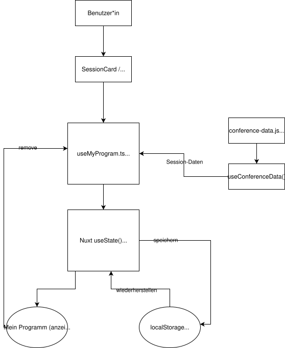

# C — State-Management-Konzept

## 1. Ausgangssituation und Zielsetzung

VuePoint ermöglicht die Suche und Filterung von Konferenz-Sessions. Als weitere Funktion ist **„Mein Programm“** vorgesehen. Nutzer*innen sollen Sessions zu ihrem persönlichen Programm hinzufügen und bei Bedarf wieder entfernen können.

Die Auswahl soll auf unterschiedlichen Seiten verfügbar sein und auch nach einem Neuladen der Anwendung erhalten bleiben.

Dieses Dokument beschreibt die geplante State-Management-Architektur. Die Funktion „Mein Programm“ ist derzeit noch nicht vollständig implementiert.

## 2. Lokaler und globaler State

VuePoint verwendet bereits reaktive Zustände mit Vue `ref()` und `computed()`, beispielsweise für die Suche und Filterung in `useSessions.ts`.

Solche Filterwerte können lokal innerhalb eines Composables verwaltet werden, da sie nicht dauerhaft gespeichert werden müssen.

Für „Mein Programm“ wird dagegen ein gemeinsam verwendeter Zustand benötigt. Die ausgewählten Sessions sollen sowohl auf den Session-Seiten als auch innerhalb des persönlichen Programms verfügbar sein.

Dafür wird ein eigenes Composable `useMyProgram.ts` vorgeschlagen. Es verwendet Nuxt `useState()`, um die Auswahl innerhalb der Anwendung gemeinsam bereitzustellen.

Ein zusätzlicher State-Management-Store wie Pinia ist für diesen begrenzten Anwendungsfall zunächst nicht erforderlich.

## 3. Datenmodell und Zustandsänderungen

Der persönliche Programmzustand enthält eine Liste ausgewählter Session-IDs (`string[]`).

Es werden nur die IDs und nicht vollständige Session-Objekte gespeichert. Die zugehörigen Informationen können über die vorhandenen Konferenzdaten ermittelt werden.

Das Composable stellt folgende Funktionen bereit:

- `addSession(id)` – Session hinzufügen.
- `removeSession(id)` – Session entfernen.
- `isSelected(id)` – Auswahlstatus überprüfen.
- `selectedSessions` – ausgewählte Sessions aus den Konferenzdaten ableiten.

Doppelte Einträge werden verhindert. Änderungen am Zustand aktualisieren die betroffenen Komponenten reaktiv.

## 4. Persistenz mit localStorage

Zur dauerhaften Speicherung wird die Browser-API `localStorage` verwendet.

Nach einer Änderung des persönlichen Programms werden die ausgewählten Session-IDs als JSON gespeichert.

Beim erneuten Öffnen der Anwendung werden die gespeicherten IDs ausgelesen und der gemeinsame Zustand wiederhergestellt.

Da `localStorage` ausschließlich im Browser verfügbar ist, erfolgt der Zugriff clientseitig, beispielsweise über `onMounted()`. Dadurch werden Fehler beim serverseitigen Rendering vermieden.

Ungültige oder nicht mehr vorhandene Session-IDs sollen bei der Wiederherstellung berücksichtigt werden.

## 5. Geplanter Datenfluss

Die folgende Abbildung veranschaulicht den geplanten Datenfluss für die Funktion „Mein Programm“.

Nutzer*innen können Sessions über die Session-Liste oder die Detailseite zu ihrem persönlichen Programm hinzufügen. Das Composable useMyProgram.ts verwaltet die Auswahl zentral mithilfe von Nuxt useState().

Die ausgewählten Session-IDs werden im localStorage gespeichert und beim erneuten Laden der Anwendung wiederhergestellt. Die Seite „Mein Programm“ zeigt die ausgewählten Sessions an und ermöglicht deren Entfernung.

Die Darstellung und die Speicherung bleiben voneinander getrennt. UI-Komponenten lösen Aktionen aus, während das Composable die Zustandsverwaltung übernimmt.

## 6. Begründung und Ausblick

Die Kombination aus Nuxt `useState()`, einem eigenen Composable und `localStorage` wird aufgrund ihrer geringen Komplexität und guten Integration in die bestehende Architektur vorgeschlagen.

Sie ermöglicht die Wiederverwendung der Zustandslogik und vermeidet zusätzliche Abhängigkeiten.

Eine Einschränkung besteht darin, dass `localStorage` nur innerhalb des jeweiligen Browsers verfügbar ist. Eine geräteübergreifende Synchronisierung ist nicht vorgesehen.

Die konkrete Implementierung und das Verhalten bei möglichen zeitlichen Überschneidungen ausgewählter Sessions werden in späteren Entwicklungsschritten behandelt.